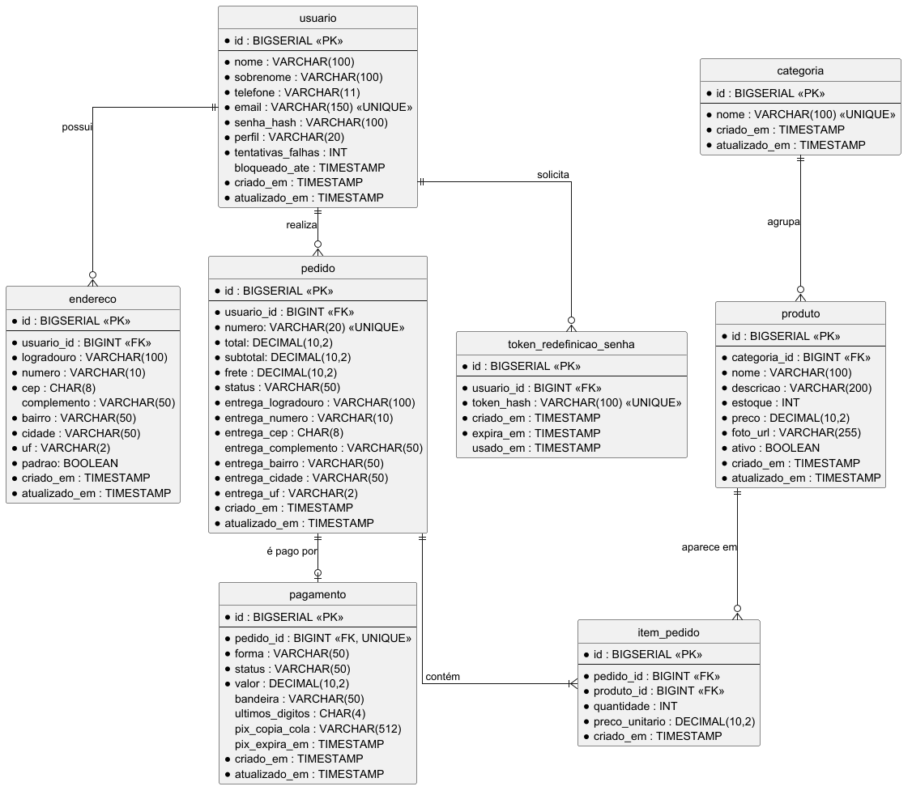
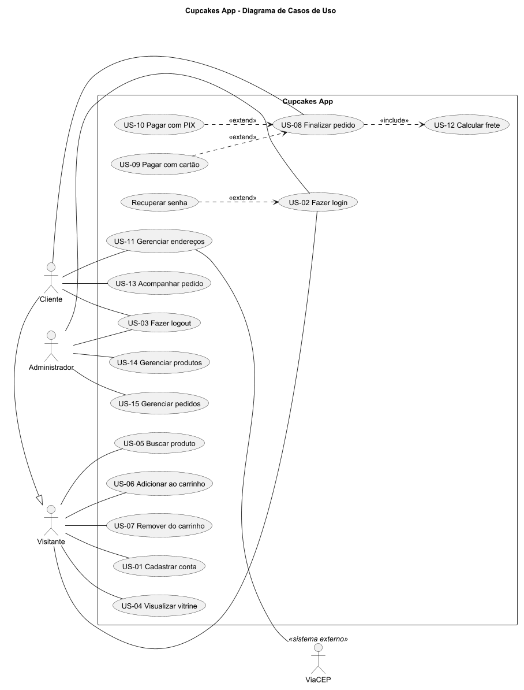
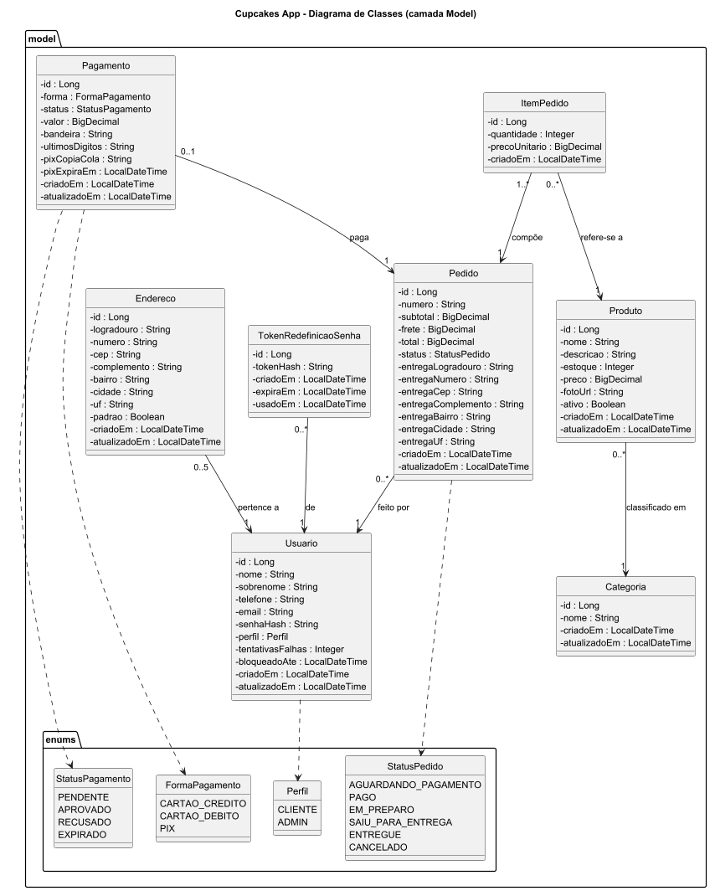
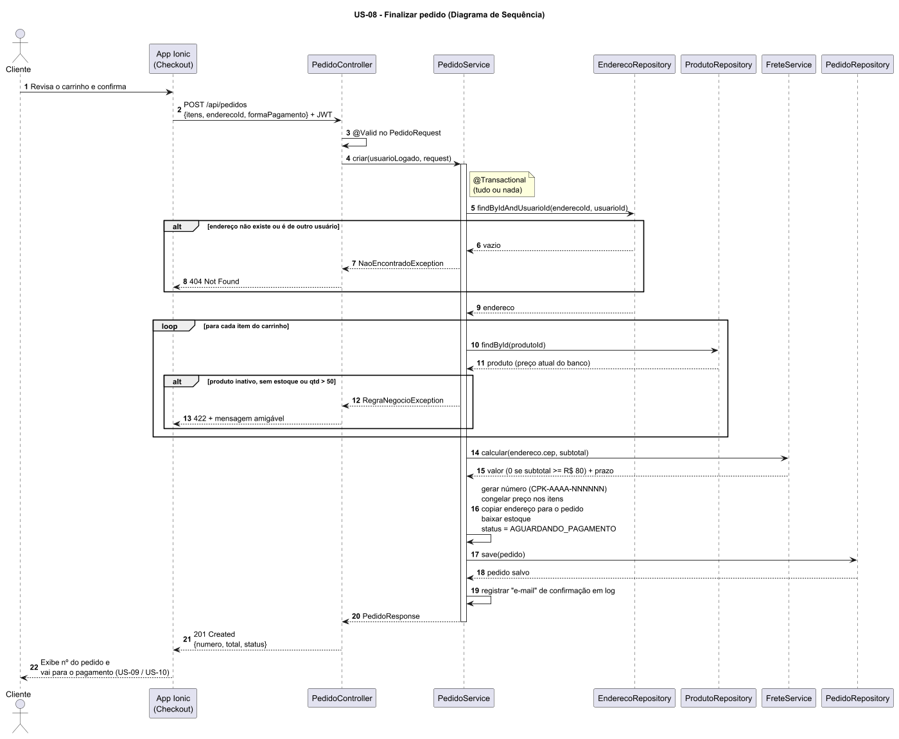

# Situação 1 — Revisão do Planejamento

- [Revisão Kaizen dos requisitos](revisao-requisitos.md)
- [Dicionário de dados](banco/dicionario-de-dados.md)

## Modelo de dados (DER)

## Casos de uso

## Diagrama de classes

## Sequência — Finalizar pedido (US-08)

## IHC
- [Wireframes, mapas e mensagens](ihc/README.md)
