# IHC — Interface Humano-Computador

## Wireframes
| Tela | Wireframe | Histórias |
|---|---|---|
| Login | 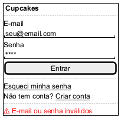 | US-02, US-03 |
| Cadastro | 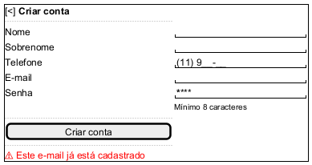 | US-01 |
| Vitrine | 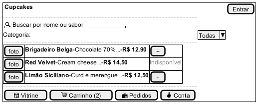 | US-04, US-05 |
| Detalhe do produto | 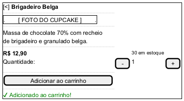 | US-04, US-06 |
| Carrinho | 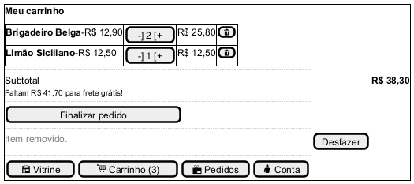 | US-06, US-07, US-12 |
| Checkout | 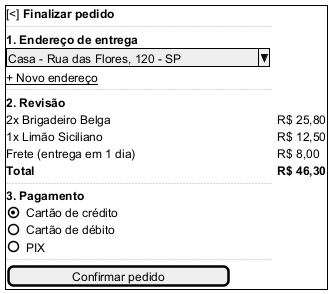 | US-08, US-11, US-12 |
| Pagamento — Cartão | 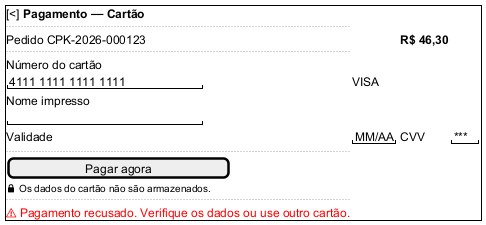 | US-09 |
| Pagamento — PIX | 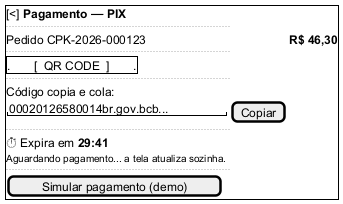 | US-10 |
| Meus pedidos | 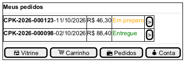 | US-13 |
| Acompanhar pedido | 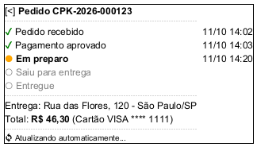 | US-13 |
| Endereços | 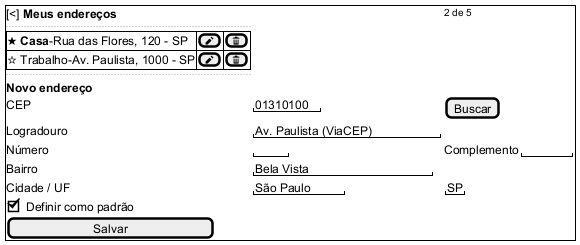 | US-11 |
| Admin — Produtos | 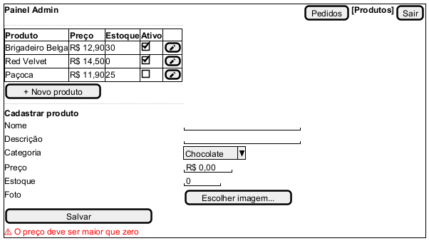 | US-14 |
| Admin — Pedidos | 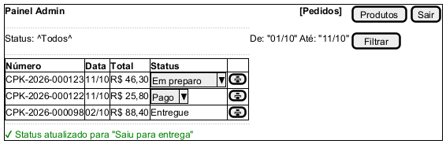 | US-15 |

## Mapa navegacional
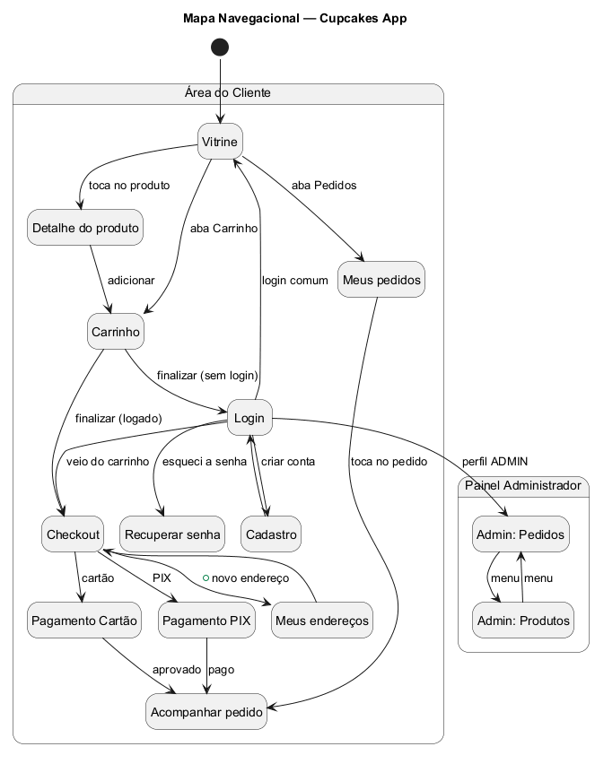

## Mapa conceitual
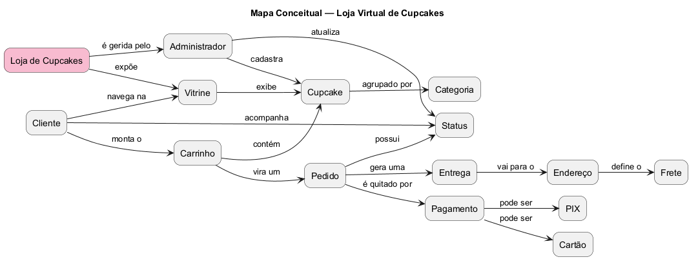

## Princípios de IHC aplicados
| Princípio (material do PIT II) | Onde aparece no app |
|---|---|
| Clareza | Preço, estoque e "Indisponível" visíveis na vitrine; formulários com rótulos |
| Consistência | Mesma barra de abas em todas as telas do cliente; botão principal sempre embaixo |
| Simplicidade | Checkout em 3 passos numerados numa só tela |
| Controle pelo usuário | Carrinho editável (+/−) antes de finalizar; o cliente escolhe endereço e pagamento |
| Ação direta | Ícone do carrinho atualiza o contador na hora (US-06) |
| Recuperável / reversível | "Desfazer" ao remover item do carrinho (US-07) |
| Feedback | Toasts de sucesso/erro, contador do PIX, status do pedido se atualizando sozinho |
| Estética | Paleta única, foto em destaque, tipografia com hierarquia (nome > descrição > preço) |

## Catálogo de mensagens
| Situação | Mensagem | Tipo |
|---|---|---|
| Login inválido (US-02 CA#2) | E-mail ou senha inválidos. | Erro (inline) |
| Conta bloqueada (US-02 RN#1) | Muitas tentativas. Tente novamente em 15 minutos. | Erro (inline) |
| E-mail já cadastrado (US-01 RN#1) | Este e-mail já está cadastrado. | Erro (inline) |
| Senha curta (US-01 CA#2) | A senha deve ter no mínimo 8 caracteres. | Erro (campo) |
| Produto adicionado (US-06 CA#3) | Adicionado ao carrinho! | Sucesso (toast) |
| Limite por item (US-06 RN#1) | Máximo de 50 unidades por produto. | Aviso (toast) |
| Item removido (US-07) | Item removido. [Desfazer] | Info (toast) |
| Carrinho vazio (US-07 RN#1) | Seu carrinho está vazio. Que tal dar uma olhada na vitrine? | Estado vazio |
| Busca sem resultado (US-05 CA#3) | Nenhum cupcake encontrado para "…". | Estado vazio |
| CEP inválido (US-11 CA#3) | CEP não encontrado. Confira os números. | Erro (campo) |
| Limite de endereços (US-11 RN#1) | Você já tem 5 endereços. Exclua um para adicionar outro. | Aviso |
| Cartão recusado (US-09 CA#2) | Pagamento recusado. Verifique os dados ou use outro cartão. | Erro (inline) |
| PIX expirado (US-10 RN#1) | O QR Code expirou. Gere um novo para continuar. | Aviso |
| Preço inválido (US-14 RN#1) | O preço deve ser maior que zero. | Erro (campo) |
| Erro de conexão | Não foi possível conectar. Verifique sua internet. | Erro (toast) |
