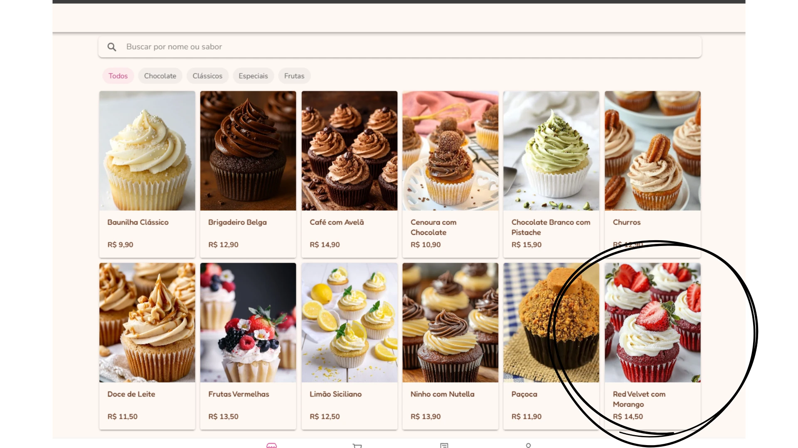
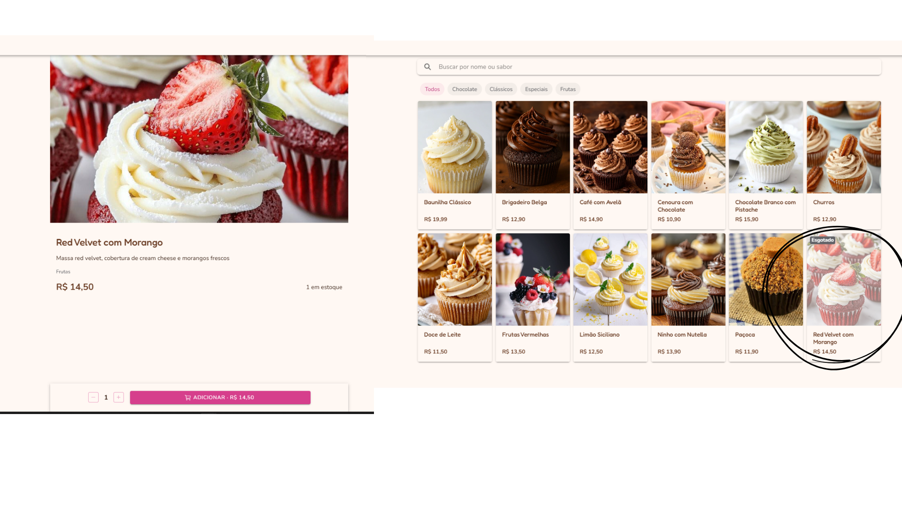
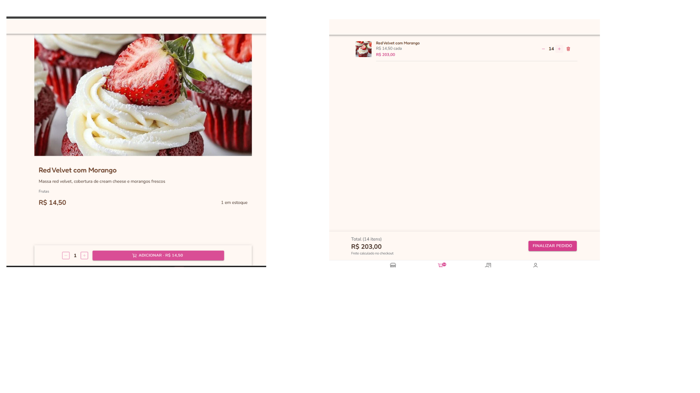
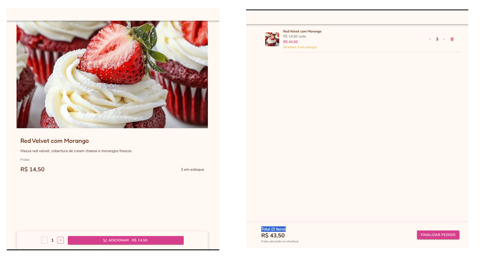
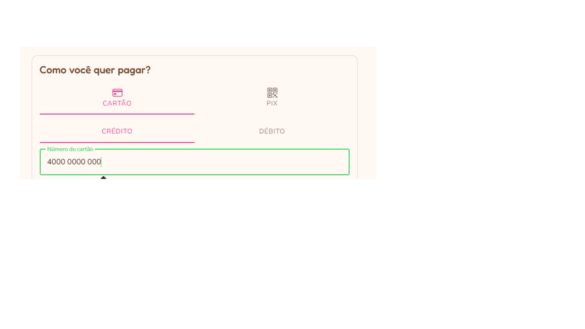
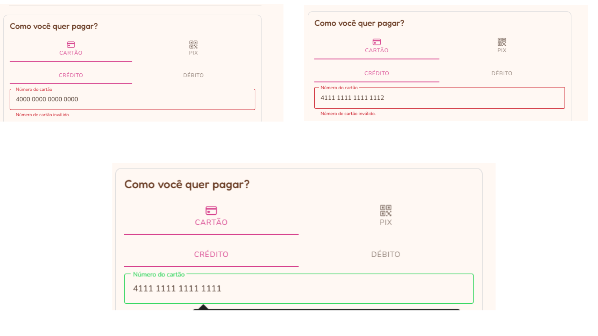
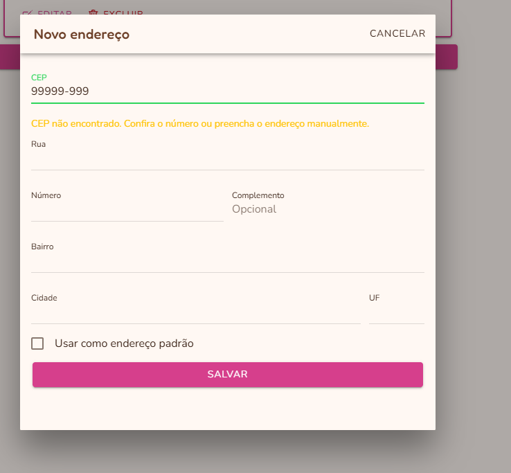
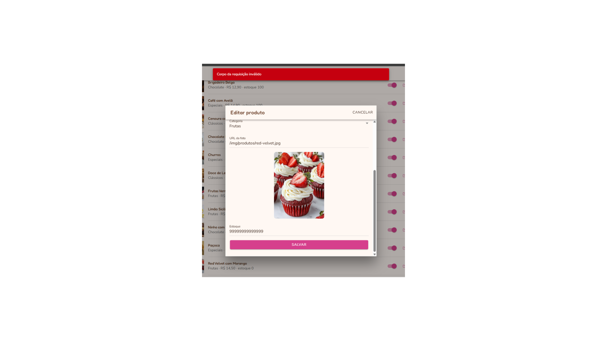
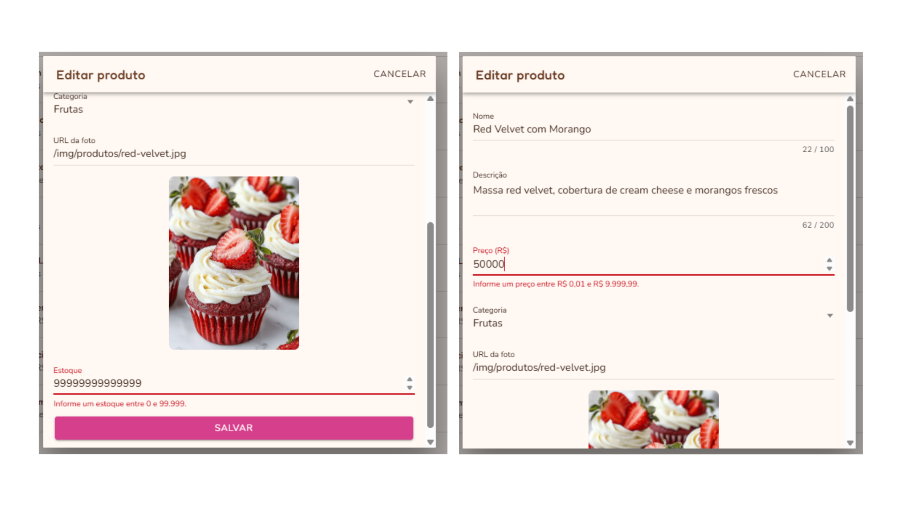

# Situação 3 — Testes com usuários e correções

A aplicação publicada foi testada por cinco pessoas entre 04/11 e 07/11/2026. Cada uma usou o sistema em produção, seguindo um roteiro de tarefas (criar conta, cadastrar endereço, montar o carrinho, pagar com cartão e com PIX, acompanhar o pedido), e relatou o que funcionou, o que não funcionou e o que faltou.

Os nomes estão abreviados para preservar a privacidade dos testadores. O registro completo, com nomes e datas, está no relatório entregue à disciplina.

## Testadores

| Testador | Data | Resumo |
|---|---|---|
| Ruan | 05/11/2026 | Testou as áreas do cliente e do admin em detalhe; encontrou 5 problemas |
| Giorgio | 06/11/2026 | Carrinho, estoque e pagamentos; nada a corrigir |
| Victor | 07/11/2026 | Compra, cadastro e validações; 4 problemas e 2 sugestões |
| Vitor | 04/11/2026 | Fluxo de compra; 1 problema (o mesmo do B1) e 1 sugestão |
| Kayky | 04/11/2026 | Acessou o site; não relatou problemas |

## Laudo de qualidade

| ID | Problema encontrado | Encontrado por | Correção |
|---|---|---|---|
| B1 | Endereço recém-cadastrado não aparecia no checkout; era preciso voltar uma tela | Ruan, Victor e Vitor | O checkout recarrega os endereços sempre que a tela é exibida e já seleciona o recém-cadastrado |
| B2 | A vitrine não mostrava "Esgotado" depois da compra sem recarregar a página | Ruan e Victor | A vitrine recarrega os produtos ao voltar a ser exibida |
| B3 | O carrinho não limitava a quantidade pelo estoque | Ruan | O carrinho guarda o estoque do produto e trava o "+" nesse valor, com aviso |
| B4 | Número do cartão incompleto aparecia como válido e aceitava dígitos demais | Victor | Validação do dígito verificador (Luhn) no front e limite de 16 dígitos |
| B5 | O telefone aceitava mais dígitos que o padrão brasileiro | Victor | O campo aceita apenas números, no máximo 11 |
| B6 | CEP não encontrado bloqueava o preenchimento manual | Ruan | **Não reproduzido:** o sistema já exibe o aviso e libera os campos |
| B7 | Estoque muito grande no admin gerava o erro genérico "corpo da requisição inválido" | Ruan | Limites de preço (R$ 9.999,99) e estoque (99.999) no front e no back, com mensagem clara |
| M1 | Melhoria: a área de compras não foi encontrada | Victor | Aba renomeada para "Minhas compras", com atalhos na Conta e após o pagamento |
| M2 | Melhoria: voltar para a vitrine após adicionar ao carrinho | Victor | Implementado, mantendo a confirmação com o botão "Ver carrinho" |
| M3 | Melhoria: tema escuro (dark mode) | Vitor | Não implementado nesta entrega; registrado para uma versão futura |

Os problemas encontrados por mais de um testador (B1 e B2) tinham a mesma causa: no Ionic, as telas continuam vivas em segundo plano e não recarregavam os dados ao voltar a ser exibidas.

### Limitação conhecida
Uma chamada direta à API com um estoque maior que 2.147.483.647 (o limite do tipo `Integer`) ainda recebe o erro genérico 400, porque o valor não é convertido antes da validação. Pela tela isso não acontece mais, pois o formulário bloqueia o envio.

## Evidências

As evidências de B1 e B5 estão apenas no relatório entregue, porque os prints mostram endereço e telefone reais.

### B2 — Vitrine não marcava "Esgotado"
| Antes | Depois |
|---|---|
|  |  |

### B3 — Carrinho sem limite de estoque
| Antes | Depois |
|---|---|
|  |  |

### B4 — Número do cartão
| Antes | Depois |
|---|---|
|  |  |

### B6 — CEP não encontrado (não reproduzido)

### B7 — Limites no cadastro de produtos
| Antes | Depois |
|---|---|
|  |  |

## Vídeos

- [Demonstração do sistema](https://www.youtube.com/watch?v=Vt-E3U0t1f0)
- [Correções após os testes](https://youtu.be/4vU0inldO4E)
